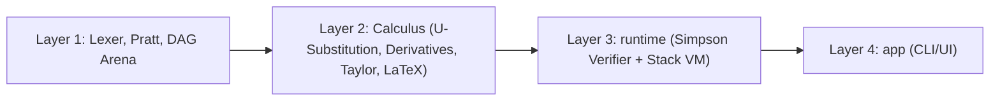

# RFC-001: SymVerify Architecture & Engineering Log

<aside>
💡

Status: Just starting | Author: Zakhar Vasylenko | Target: Summer 2027 Co-op Portfolio

</aside>

## Goals:

- Perform common actions (u substitutions, integration by parts, basic derivatives, Taylor polynomials) on mathematical expressions
- Raw expression strings are converted into a DAG to avoid excessive RAM usage
- Math is verified numerically to ensure correct answers are given
- Easy to navigate GUI that intuitively provides access to all 4 operations, via mouse-based inputs or keyboard-based commands
- Full Latex displayed, step by step solutions that simplify understanding of a problem

## Non-Goals:

- v1 is not scoped to perform operations outside of standard textbook techniques (if there is no closed form elementary solution, it will not be solved).
- Will not implement AI or LLM comprehension of any kind, understanding of entered equation should be done directly in code
- v1 is not scoped to save history of equations

## System Architecture

## Mathematical Invariants

$$
E_1 \equiv E_2 \iff id(E_1) = id(E_2) 
$$

- No duplicate nodes

$$
\frac{d}{dx} F(x) = f(x)
$$

- Computed integral must equal original expression

## ADRs

| ID | Status | Context | Decision | Consequences |
| --- | --- | --- | --- | --- |
| ADR-001: Implementation Language | Accepted | Option A: All Python
Option B: L 1/2 Python + L 3 C++20 | Option B, as it speeds up development while still focusing on speed in Layer 3 | Python may not be the most performant for L1/2, while C++20 has a learning curve, especially for goals of L3 |
| ADR-002: Representing DAG Nodes in memory | Accepted | Option A: OOP Subclasses (i.e. AddNode, SinNode etc.)
Option B: Tuple table indexed by int | Option B, every child will be an int which will be easily hashable by dict in Python | Nodes will just be plain data types, so math operations must be put into separate Visitor classes |
| ADR-003: Binary + and * vs N-ary Add and Mul | Accepted | Option A: Strictly Binary Nodes 
Option B: N-ary Nodes | Option A, binary nodes are way simpler to implement, N-ary can be considered later | Left associate folding, long chained equations have to be nested in pairs (Add(Mul(Add ….. etc.) |
| ADR-004: Step by Step LaTeX proofs | Accepted | Option A: Side Channel Proof Logger, visitor method appends each step to an internal list stored inside itself. Differentiation function can just return node_id
Option B: Every single recursive steps returns previous mini steps, plus a new node_id | Option A, as it is least messy to write and will also benefit RAM usage | Internal list must be stored precisely to ensure every step is accounted for  |
| ADR-005: Catching cyclic integrals in IBP | Accepted | When doing Integration by Parts on certain function (like e^x sin(x) dx), the original integral would reappear on the right side, which will cause an infinite loop | seen_integrals list will detect when original IDs reappear and stop recursive solving | Prevents infinite loops crashes and allows solving of infinite integrals.  |
- Lexer & Pratt Parser Logs
- Hash-Consed DAG & Visitors Logs
- Calculus II & Simpson Verifier Logs
- Stack Bytecode VM Logs